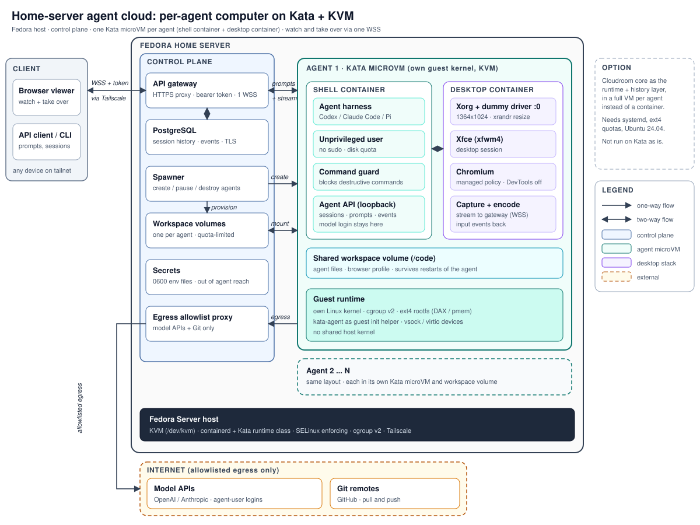

# Architecture

## Goals

1. Each agent has its own computer: shell, desktop, browser, persistent files.
2. Strong isolation between agents and from the host.
3. The owner can watch and take over any agent from any device on the tailnet.
4. Runs on one Fedora home server; no external hosting required.
5. Small, modular, replaceable parts.

## Components

### Host
Fedora Server on bare-metal KVM (nested KVM works but is slower and more fragile).
containerd runs containers; the Kata runtime class launches each one inside a
lightweight VM with its own guest kernel. SELinux stays enforcing. cgroup v2 is the
Fedora default.

### Control plane
Built as one deployable with clear module boundaries (see [ADR-005](decisions.md)).

| Module | Responsibility |
|---|---|
| Gateway | HTTPS entry point, bearer-token auth, proxies one WSS per viewer and the agent API |
| Spawner | Creates, pauses and destroys agents; provisions workspace volumes |
| Session store | PostgreSQL schema for sessions and events, TLS to the database |
| Workspace volumes | One quota-limited volume per agent |
| Secrets | Root-owned 0600 env files; never readable by the agent user |
| Egress proxy | Allowlist for model APIs and Git hosts; everything else dropped |

### Agent microVM (one per agent)
- **Shell container:** unprivileged user, no sudo, the agent harness, a command guard
  against destructive commands, and a loopback-only agent API. Model logins live in
  this user's home, not in control-plane config.
- **Desktop container:** Xorg with the `dummy` video driver on `:0`, Xfce (xfwm4),
  Chromium with machine-level managed policy, and a capture-and-encode step that
  streams to the gateway. The display is resized with `xrandr` to match the viewer.
- **Shared workspace volume** mounted into both containers.
- **Guest runtime:** its own kernel, cgroup v2, ext4 rootfs.

> Pod shape is an open decision: one container running both stacks under a
> supervisor, or two containers in one pod. See [ADR-004](decisions.md).

## Data flows

| # | Flow | Path |
|---|---|---|
| 1 | Prompt | Client, gateway (token), agent API in the shell container |
| 2 | Watch / take over | Client, gateway (single WSS), capture/encode in the desktop container; input events return the same way |
| 3 | Model calls | Harness, egress proxy, model API |
| 4 | History | Agent API events, gateway, PostgreSQL |
| 5 | Lifecycle | Gateway, spawner, containerd (Kata runtime class), workspace volume mount |

## Trust boundaries

1. **Client to gateway:** tailnet plus bearer token. No public exposure.
2. **Gateway to agent:** the only path into a microVM; agents never listen publicly.
3. **Agent to host:** hardware virtualization. The agent user has no sudo and no
   access to the containerd socket.
4. **Agent to internet:** only through the egress proxy and its allowlist.
5. **Agent to agent:** separate microVMs and separate workspace volumes.

## Why Kata

Observation of ChatGPT Dots' sandbox showed Kata Containers on KVM (boot line with
`systemd.unit=kata-containers.target`, `systemd-detect-virt --vm` = kvm). Kata gives
per-agent VM isolation with a container workflow, avoiding hand-built kernels,
rootfs images and networking. See [research-notes.md](research-notes.md).

## Desktop stack

Xorg + dummy driver, Xfce and policy-locked Chromium mirror what was observed in
Dots' desktop (X11 `:0`, `DUMMY0` at a custom resolution, managed Chromium policies).
The viewer protocol is **unknown**; see [ADR-006](decisions.md) for the chosen
starting point.
